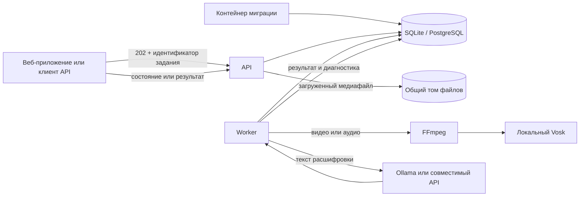

# Архитектура

Одноразовый контейнер миграций применяет изменения схемы до запуска API и worker. API проверяет запрос, сохраняет задание и предоставляет его состояние и результат. Worker получает задание через аренду, хранящуюся в базе данных. В производственном режиме методы работы с заданиями и библиотекой требуют общий токен Bearer; учётных записей нет.

Для видео и аудио FFmpeg преобразует дорожку в моно PCM 16 кГц, после чего Vosk локально распознаёт речь. Выбор демультиплексора фиксирован для расширения файла, список сетевых протоколов ограничен, а дочерние процессы имеют тайм-аут. LLM выполняет два отдельных этапа: нормализацию расшифровки и составление конспекта. При превышении контекстного окна текст разбивается на фрагменты; результаты фрагментов объединяются в общий конспект. Текстовый ввод проходит те же этапы, пропуская преобразование медиа и распознавание.

## Границы компонентов

- `apps/api` — HTTP-маршруты, проверка загрузок, Swagger, диагностика и история браузерного SPA.
- `apps/web` — русскоязычное SPA на Vue и Tailwind, библиотека конспектов и навигация по URL.
- `apps/worker` — очередь, аренда заданий, повторы, обработка медиа и оркестрация вызовов LLM.
- `packages/database` — доступ к SQLite и PostgreSQL, миграции и операции очереди и библиотеки.
- `packages/media` — проверка медиафайлов, FFmpeg и Vosk.
- `packages/llm` — провайдеры Ollama и OpenAI-compatible, шаблоны запросов, разбиение и проверка результатов.
- `packages/domain` — состояния задания, типы конспектов и схема результата.
- `packages/config` — чтение и проверка переменных среды при запуске.

## Восстановление и хранение

Worker регулярно продлевает аренду задания. Если срок аренды истёк, задание возвращается в очередь или переводится в окончательный сбой после достижения `JOB_MAX_ATTEMPTS`. Токен аренды не позволяет старому worker записать результат после того, как задание получил другой процесс. Повторы выполняются с настраиваемой задержкой.

Исходный медиафайл удаляется сразу после успешного распознавания. При окончательном сбое он также удаляется, а код и безопасное описание ошибки остаются в записи задания. Задания, тексты и результаты удаляются по истечении `JOB_RETENTION_DAYS`. Сохранённые конспекты библиотеки имеют отдельный срок хранения: они остаются до ручного удаления. Worker также удаляет старые неиспользуемые файлы из каталога загрузок.

## Выбор базы данных

SQLite рассчитана на один локальный worker и удобна для личного использования. PostgreSQL обеспечивает безопасное распределение заданий между несколькими worker за счёт блокировок строк. Производительный Compose-файл задаёт базовые ограничения контейнеров для одного сервера, но сам по себе не настраивает TLS, управление секретами, резервное копирование PostgreSQL или распределённое ограничение запросов. Для публикации в сети эти меры должен предоставить оператор инфраструктуры.
