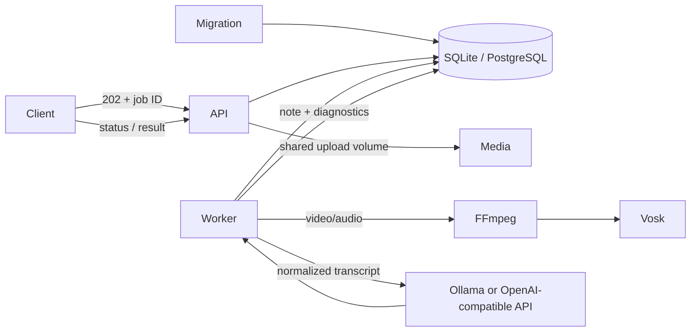

# Architecture

The one-shot migration container applies database migrations before API and worker startup. The API validates and stores requests, and exposes job status and results. Production job routes require a shared bearer token; there are no user accounts. A worker claims jobs through a database lease token that fences stale workers from writing after a lease is recovered. Uploaded media is converted to mono 16 kHz PCM by FFmpeg, then transcribed locally by Vosk. FFmpeg and ffprobe use a fixed demuxer selected by the upload extension, a restricted protocol allowlist, and a timeout. The LLM normalizes the transcript and creates a structured note in separate logical stages. Stage instructions live in editable text files under `packages/llm/prompts`; set `PROMPTS_DIRECTORY` to use an alternate directory. Text input skips media conversion and speech recognition.

## Runtime boundaries

- `apps/api`: HTTP, upload validation, Swagger, health, job submission/status/result.
- `apps/worker`: queue polling, leases, retries, media and language-model orchestration.
- `packages/database`: SQLite/PostgreSQL access and schema setup.
- `packages/media`: media metadata, FFmpeg, Vosk.
- `packages/llm`: Ollama and OpenAI-compatible adapters, prompts, chunking, output validation.
- `packages/domain`: job types and note contract.
- `packages/config`: environment parsing and startup validation.

## Recovery and retention

Workers renew their lease while active. Expired leases return to the queue until the maximum attempt count, then become terminal. Lease tokens ensure that workers with a recovered lease cannot overwrite the new owner's state. Failures are retried up to `JOB_MAX_ATTEMPTS`; terminal errors are stored internally and mapped to safe public messages. Uploaded media is deleted after transcription or terminal failure; old orphaned uploads are swept after `UPLOAD_ORPHAN_RETENTION_HOURS`. Job rows and text/results expire after `JOB_RETENTION_DAYS`.

The Compose production overlay is a single-host deployment baseline. It does not configure TLS, managed secrets, PostgreSQL backups, or a distributed rate limiter; deploy behind an operator-managed TLS gateway and provide those platform controls before internet exposure.
