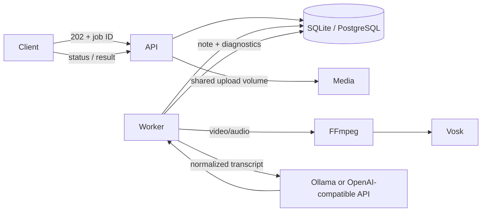

# Architecture

The API validates and stores requests, and exposes job status and results. A worker claims jobs through a database lease. Uploaded media is converted to mono 16 kHz PCM by FFmpeg, then transcribed locally by Vosk. The LLM normalizes the transcript and creates a structured note in separate logical stages. Text input skips media conversion and speech recognition.

## Runtime boundaries

- `apps/api`: HTTP, upload validation, Swagger, health, job submission/status/result.
- `apps/worker`: queue polling, leases, retries, media and language-model orchestration.
- `packages/database`: SQLite/PostgreSQL access and schema setup.
- `packages/media`: media metadata, FFmpeg, Vosk.
- `packages/llm`: Ollama and OpenAI-compatible adapters, prompts, chunking, output validation.
- `packages/domain`: job types and note contract.
- `packages/config`: environment parsing and startup validation.

## Recovery and retention

Workers renew their lease while active. Expired leases return to the queue. Failures are retried up to `JOB_MAX_ATTEMPTS`; terminal failures retain a readable error. Uploaded media is deleted after transcription or terminal failure. Job rows and text/results expire after `JOB_RETENTION_DAYS`.
